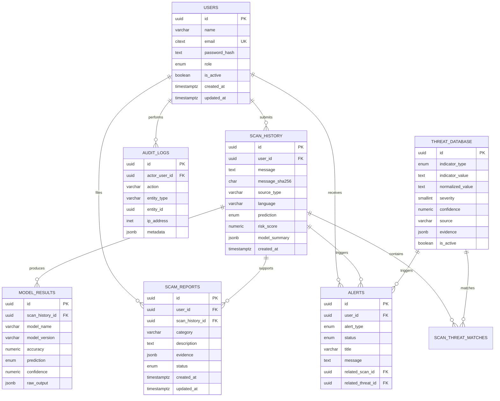

# ScamShieldAI Database System

## Database Choice

ScamShieldAI uses PostgreSQL as the system of record for users, scan history, scam reports, threat indicators, alerts, model outputs, and audit events.

PostgreSQL is appropriate because the product needs relational integrity, transactional writes, JSONB flexibility for evolving AI evidence, strong indexing, and mature security controls.

## ER Diagram



## SQL Schema

Canonical migration:

```text
infra/db/migrations/0002_create_core_product_schema.sql
```

The schema creates:

- `users`
- `scan_history`
- `scam_reports`
- `threat_database`
- `scan_threat_matches`
- `alerts`
- `model_results`
- `audit_logs`

It also creates PostgreSQL enum types, timestamp triggers, constraints, indexes, and a foreign key from the existing `scam_analyses.user_id` column to `users.id`.

## Table Design

### Users

Stores platform identities.

Required user-facing fields:

- `id`
- `name`
- `email`
- `password`
- `role`

Database implementation:

- `password` is stored as `password_hash`; plaintext passwords must never be stored.
- `email` uses `CITEXT` for case-insensitive uniqueness.
- `role` uses the `user_role` enum: `user`, `analyst`, `admin`, `super_admin`.

### ScanHistory

Stores each analyzed message submitted by a user.

Key fields:

- `user_id`
- `message`
- `message_sha256`
- `prediction`
- `risk_score`
- `created_at`

`message_sha256` supports deduplication and investigation without relying only on raw message text.

### ScamReports

Stores user or analyst reports about scams.

Key fields:

- `category`
- `description`
- `evidence`
- `status`

`evidence` is JSONB because scam evidence can include screenshots, URLs, extracted entities, wallet addresses, phone numbers, and analyst notes.

### ThreatDatabase

Stores known malicious indicators.

Supported indicator types:

- `malicious_url`
- `phone_number`
- `keyword`
- `domain`
- `email_address`
- `crypto_wallet`

`indicator_value` preserves the original value, while `normalized_value` supports matching and uniqueness.

### ScanThreatMatches

Join table between scans and threat indicators.

Reason: a scan can match multiple indicators, and one threat indicator can appear in many scans.

### Alerts

Stores user-facing or analyst-facing notifications.

Key fields:

- `user_id`
- `alert_type`
- `status`
- `related_scan_id`
- `related_threat_id`

### ModelResults

Stores model outputs for a scan.

Key fields:

- `model_name`
- `model_version`
- `accuracy`
- `prediction`
- `confidence`
- `raw_output`

`accuracy` is stored from `0.0000` to `1.0000`. `confidence` is stored from `0` to `100`.

### AuditLogs

Stores security and compliance events.

Examples:

- login attempts
- scan creation
- report status changes
- threat indicator updates
- admin access
- model result overrides

Audit logs reference an actor user when available but keep logs if a user is deleted.

## Relationships

- `users.id` -> `scan_history.user_id`: one user can submit many scans.
- `users.id` -> `scam_reports.user_id`: one user can submit many reports.
- `users.id` -> `alerts.user_id`: one user can receive many alerts.
- `users.id` -> `audit_logs.actor_user_id`: one user can perform many audited actions.
- `scan_history.id` -> `model_results.scan_history_id`: one scan can have many model outputs.
- `scan_history.id` -> `scam_reports.scan_history_id`: a report can be linked to a scan.
- `scan_history.id` -> `scan_threat_matches.scan_history_id`: one scan can match many threat indicators.
- `threat_database.id` -> `scan_threat_matches.threat_id`: one indicator can match many scans.
- `scan_history.id` -> `alerts.related_scan_id`: alerts can reference scans.
- `threat_database.id` -> `alerts.related_threat_id`: alerts can reference threat indicators.

## Indexing Strategy

### Users

- Unique index on `email` for login and account lookup.
- Index on `role` for admin/user management filters.
- Index on `(is_active, created_at DESC)` for operational user lists.

### ScanHistory

- `(user_id, created_at DESC)` for user dashboards.
- `(prediction, created_at DESC)` for analyst triage.
- `risk_score DESC` for high-risk queues.
- `message_sha256` for deduplication.
- `(source_type, language)` for analytics and multilingual segmentation.

### ScamReports

- `(user_id, created_at DESC)` for user report history.
- `scan_history_id` for scan-linked reports.
- `(category, status)` for analyst queues.
- GIN index on `evidence` for JSONB evidence search.

### ThreatDatabase

- Unique `(indicator_type, normalized_value)` for exact matching.
- `(indicator_type, is_active)` for fast active indicator lookup.
- `(severity DESC, confidence DESC)` for prioritization.
- `last_seen_at DESC` for threat intelligence freshness.
- Partial index on active, non-expiring indicators.
- GIN index on `evidence` for intelligence metadata queries.

### Alerts

- `(user_id, status, created_at DESC)` for notification inboxes.
- `(alert_type, created_at DESC)` for alert analytics.
- `related_scan_id` and `related_threat_id` for traceability.
- Partial unread index for pending/sent alerts.

### ModelResults

- `(scan_history_id, created_at DESC)` for per-scan model output history.
- `(model_name, model_version, created_at DESC)` for model monitoring.
- `(prediction, created_at DESC)` for model behavior analytics.
- GIN index on `raw_output` for explainability and debugging queries.

### AuditLogs

- `(actor_user_id, created_at DESC)` for user investigations.
- `(entity_type, entity_id)` for entity timelines.
- `(action, created_at DESC)` for compliance reviews.
- BRIN index on `created_at` for large append-only audit tables.
- GIN index on `metadata` for structured audit searches.

## Security Considerations

1. Passwords

   Store only password hashes in `users.password_hash`. Use Argon2id or bcrypt in the application layer. Never store plaintext passwords.

2. PII and scam content

   `scan_history.message` may contain sensitive personal or financial information. Restrict access by role, encrypt database storage at rest, and define a retention policy.

3. Least privilege

   Use separate database users for migrations, application runtime, analytics, and read-only support access.

4. Row-level access

   Application logic should enforce that normal users can only access their own scans, reports, and alerts. PostgreSQL Row Level Security can be added later when the auth context is passed into database sessions.

5. Auditability

   Write security-sensitive events to `audit_logs`, including actor, action, entity, IP address, user agent, and metadata.

6. Threat indicator safety

   Treat values in `threat_database` as untrusted. Do not render URLs as clickable links by default in admin or user interfaces.

7. JSONB evidence validation

   Validate evidence schemas in the API before writing JSONB. JSONB is flexible, but uncontrolled shapes can become difficult to secure and query.

8. Data deletion

   `scan_history` cascades on user deletion to support privacy deletion. `audit_logs` retain events with `actor_user_id` set to null for compliance continuity.

9. Production backups

   Enable encrypted backups, point-in-time recovery, and tested restore procedures.

10. Monitoring

    Monitor failed login events, high-risk scan spikes, threat indicator changes, report status changes, and admin actions.